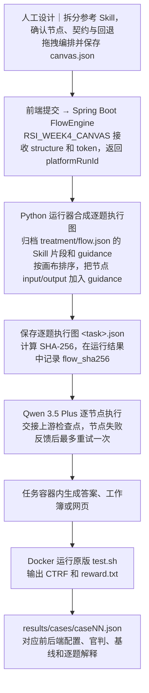

# SkillLearnBench 第四周｜人工拆分 Skill 与平台编排

**同一批十个实例 · 完整人工 Skill 基线 0/10 → 平台编排与定向补跑 10/10 官方整题通过。**

[十案例交付索引](results/cases/) · [原平台官判](results/platform/ACCEPTANCE.md) · [指定前后端复测](RUN.md#指定前后端逐题复测)

## 从画布到官方判分

正式结果按十个选中的失败基线实例统计，包含定向补跑。评审回放读取归档数据。新的实跑按当次官判计分，已保存股票第 4 题独立实跑的 13/16 负结果。 [同输入配对 CSV](results/platform/comparison.csv) · [独立实跑报告](results/reviewer-smoke/stock-4/ctrf.json)

## 学长如何复测

- **正式复测** · 按说明启动指定前端和 Spring Boot，配置百炼 Key 和 Docker，使用 `run-platform-cases.ps1` 逐题提交 case01–case10。脚本核对 Spring Boot 运行 ID、保存的画布和本次判分。 [正式复测步骤](RUN.md#指定前后端逐题复测)
- **查看归档** · 在总仓库运行 `powershell -NoProfile -ExecutionPolicy Bypass -File .\review.ps1`，打开 `/test/week4` 并点「回放节点归档」。可展开子 Skill 和节点产物。 [回放步骤](RUN.md#评审快速启动)

## 仓库提交

- 我的后端项目 [rsi-data-spring-boot](https://github.com/cooper-nine/rsi-data-spring-boot)
- 我的前端项目 [rsi-data-platform](https://github.com/cooper-nine/rsi-data-platform)
- 我的前端编排框架 [rsi-data-visual](https://github.com/cooper-nine/rsi-data-visual) 增加了可直接安装的构建产物和构建说明，供评审脚本装载原画布组件。
- 我的后端 RSI 编排框架 [rsi-flow](https://github.com/cooper-nine/rsi-flow) 增加了独立的 Java 有界 Skill 循环节点、测试和示例。十题正式实验由 Spring Boot 的 FlowEngine 调度 Python 运行器，逐节点执行由 Python 负责。

## 数据集与实验边界

每类任务 $i$ 使用固定版本的 SkillLearnBench 四元组 $(x_i, Q_i, v_i, S_i)$。本实验从四类任务的实例集中挑出十个已有失败基线的实例。下表的题号指实例编号。

| 组成 | 含义与用途 |
| --- | --- |
| $x_i$ | 任务说明，定义要完成的工作和交付格式。运行时使用所选实例自带的 `instruction.md`。 |
| $Q_i$ | 同类任务下的一批实例，各实例带自己的数据和任务环境。同一个实例的基线与编排复测使用同一份原始输入。 |
| $v_i$ | 只读验收规则。每个实例使用固定提交里的原版 `tests/test.sh` 及其关联测试。业务节点执行时隔离测试，最终验收阶段由 Docker 挂载并运行原版脚本，读取 CTRF 和 `reward.txt`。 |
| $S_i$ | 论文基准规定的人工参考 Skill，即任务作者提供的 `skills/human_authored/<任务族>/` 下的原始 Skill。同一任务族可以有多份文件，例如金融同时使用基金名称搜索与 13F 分析。 |

基线使用原始完整人工 Skill。编排版先从同一份 $S_i$ 按职责切分，再添加节点输入输出契约、连线和重试反馈。导出脚本记录当时工作区中原文件的 SHA-256。片段按原顺序拼回后与导出时读取的文件逐字节一致。将 Windows 与 Git 的换行统一后，拼回文本与固定提交中的原始 Skill 一致。运行时 Qwen 可读取任务说明、该节点的参考片段、原始数据和上游检查点。任务提示、节点契约和分阶段调用都是本次编排的一部分。 [固定基准版本](upstream-reference/source.json) · [原始人工参考 Skill](https://github.com/cxcscmu/SkillLearnBench/tree/726e1f79b96b0cb3d729d0e55a1c847e0b5353ae/skills/human_authored) · [切分脚本](qwen/export_rsi_flows.py)

## 四类编排

| 任务及实例 | 人工参考 Skill | 节点顺序与交接 |
| --- | --- | --- |
| 地震板块 5 | `geospatial-analysis` | **检查输入 → 筛选地震 → 计算距离 → 组装并检查答案**。先确认记录字段和坐标，再交接板块、事件及坐标。测距节点用板块边界生成距离，最后核对事件标识和结果格式，输出 `answer.json`。 |
| 金融分析 1、3 | `fuzzy-name-search`、`13f-analyzer` | **确认基金申报 → 计算持仓与变化 → 组装并检查答案**。先把基金名对应到各季度申报编号，再按题目要求计算规模、持仓和排名，最后检查答案字段与列表，输出 `answers.json`。 |
| 加权 GDP 1、4、5 | `xlsx` | **确认工作簿要求 → 定位数据与年份 → 写公式与加权 → 重算并检查**。先明确目标单元格、公式和模板约束，再交接数据块与年份映射。计算节点填写公式，检查节点定位引用和兼容性错误，输出 `gdp.xlsx`。 |
| 股票可视化 1、2、3、4 | `d3-visualization` | **检查数据与依赖 → 画气泡图和表格 → 实现悬停和联动 → 浏览器检查**。先交接文件、字段和输出要求，再生成页面、气泡图与表格。交互节点在渲染产物上补上提示框与联动，最后检查网页、数据和交互产物。 |

节点失败时，把错误反馈给负责该产物的节点，并保留可复用的上游检查点。四类流程的最后一步都是运行相应实例的官方判分。 [节点配置](qwen/flows/) · [平台画布截图](results/qwen-canvas/) · [逐题运行和回退证据](results/PLATFORM.md)

## 实验记录

[逐题输入与基线失败项](results/CASE-EVIDENCE.md) · [失败分析与下一阶段指标](results/QWEN-PILOT.md) · [运行清单](qwen/cases.json)
