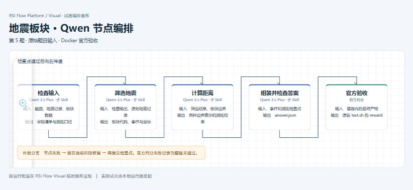
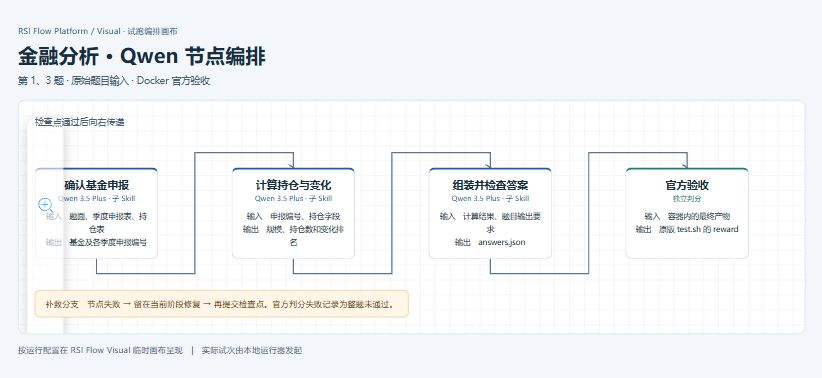
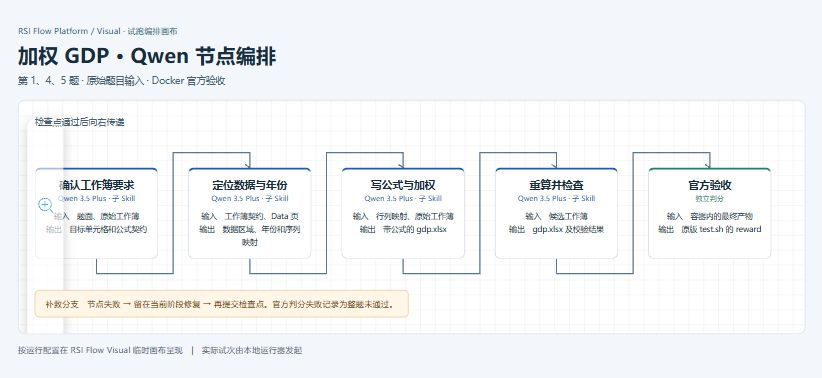
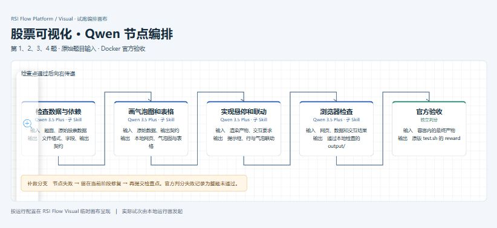

# Qwen 3.5 Plus 编排画布

| 任务族 | 浏览器截图 |
| --- | --- |
| 地震板块 | [地震](earthquake.jpg) |
| 金融分析 | [金融](financial.jpg) |
| 加权 GDP | [GDP](gdp.jpg) |
| 股票可视化 | [股票](stock.jpg) |

截图在临时 RSI Flow Visual 前端中呈现节点、输入输出契约、失败回退及官方判题环节。实际 Qwen 调用和 Docker 官方判分由本地运行器发起。截图记录编排逻辑，运行结果由试次证据单独记录。

## 地震板块

## 金融分析

## 加权 GDP

## 股票可视化

