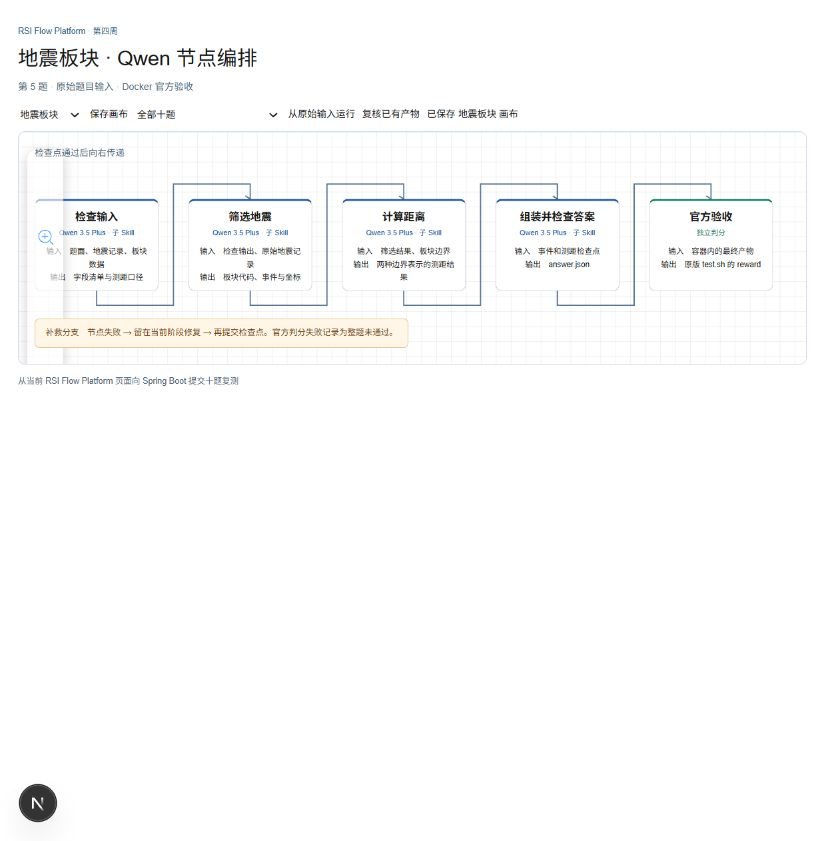
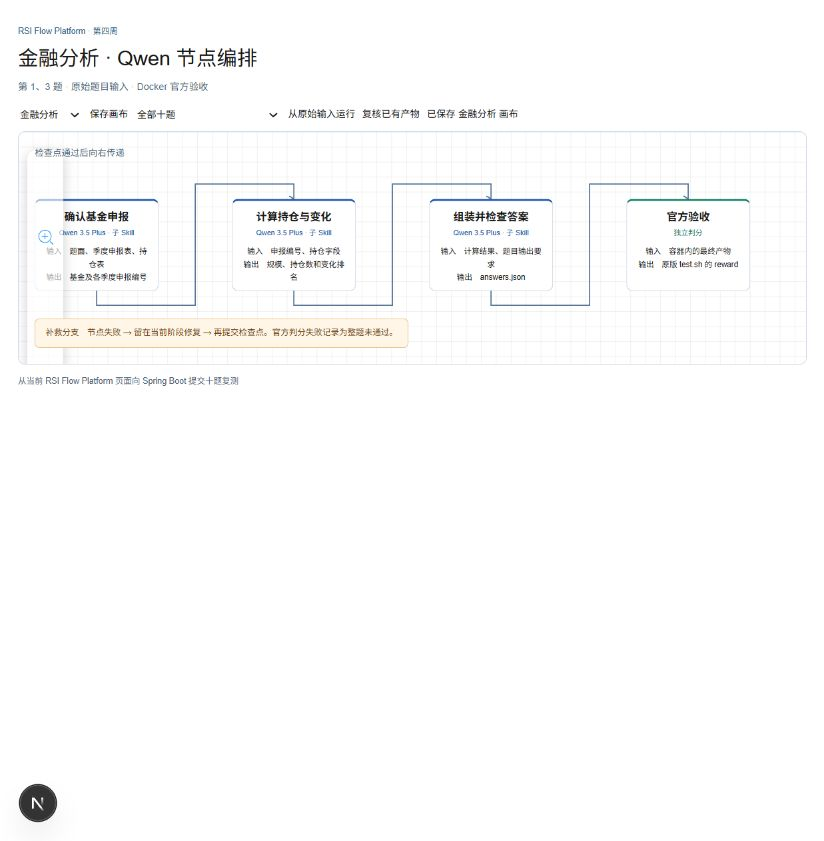
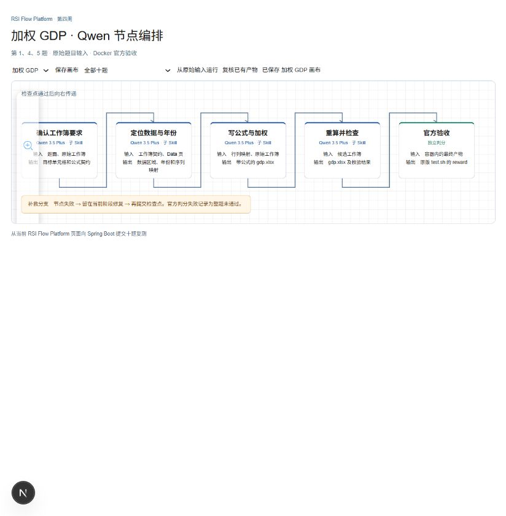
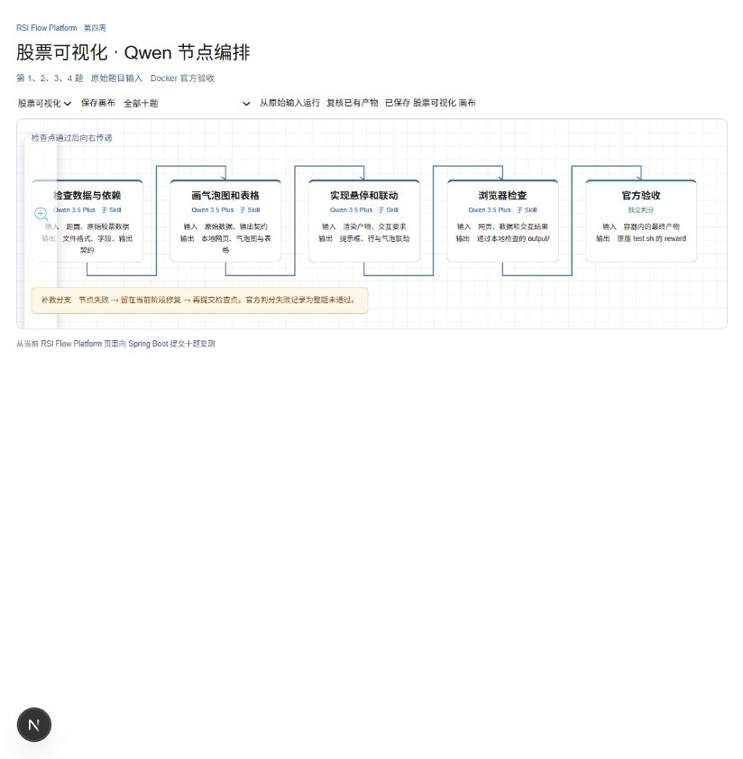

# RSI Flow Platform 编排画布

以下截图来自原 `rsi-flow-platform` 项目的 `/test/week4`，每张都记录保存后的节点、连线、输入输出契约和回退规则。整题结果见[平台验收表](../platform/ACCEPTANCE.md)。

## 地震板块

## 金融分析

## 加权 GDP

## 股票可视化

早期临时 Visual 前端截图保留为过程记录。[地震](earthquake.jpg) · [金融](financial.jpg) · [GDP](gdp.jpg) · [股票](stock.jpg)
